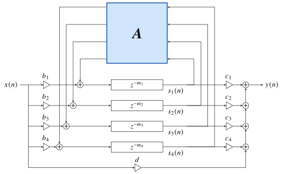
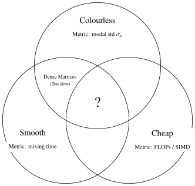
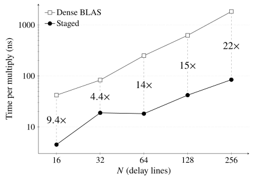

# Structured Pruning of Feedback Delay Networks

A perceptually lossless pruning algorithm for Feedback Delay Networks (FDNs).

<a href="https://github.com/cucuwritescode/fdn_pruning">Code on GitHub</a> &middot; paper on arXiv soon

## Background

### Feedback Delay Networks
- FDN's are recursive filters used for artificial reverb and decorrelation.
- Amongst other methods to synthesise reverberation, FDN's are particularly efficient computationally, nonetheless their time complexity is <em>O</em>(<em>N</em>2).

Here's a 4x4 FDN:

As shown, they consist of a set of delays and a feedback matrix through which the delay outputs are coupled to the delay inputs. The highlighted feedback matrix is the only part we touch.

### The ideal FDN triad

This paper formalises a threefold trade-off that's featured on this line of research since its early days.

As shown on the diagram, known structures don't fully satisfy all three requirements simultaneously. This work flips the design approach of FDN's from a "ground-up" to a "top to bottom" perspective:

> What if we start from a differentiable (trained), nice-sounding, dense FDN and try to prune it without losing perceptual/acoustic quality, instead of designing it with the lowest possible N&times;N feedback matrix?

## Method

The dense feedback matrix is replaced by a few stages of fixed routing and small orthogonal blocks, fitted in two phases:

- **Matrix fitting.** Match the dense matrix entry by entry; each small block has an exact closed-form update.
- **Response refinement.** Adjust all blocks jointly so the complete reverberator's magnitude response matches the dense one.

Every stage is orthogonal by construction, so the pruned FDN preserves energy exactly, at every step of the optimisation. Delays, gains and attenuation stay fixed; only the mixing changes.

## Benchmark Results

Compiled C++ with ARM NEON intrinsics on Apple M2, vs Apple Accelerate BLAS (SGEMV). Labels give speedups over isolated-call dense BLAS; staged times are measured in blocks of 512 calls.

The fastest benchmarked kernels use radix-4 at *N* = 16, 32, 64, 128 and pairwise stages at *N* = 256. At *N* = 256, coefficient storage falls from 65,536 to 768 floats.

## Impulse Responses

<h3>N = 64, radix-4, L = 2 13.7&times; faster</h3>

  

    
Dense (trained)

    <audio controls preload="none"><source src="audio/IR_N64_dense.wav" type="audio/wav"></audio>
  

  

    
Radix-4 (projected)

    <audio controls preload="none"><source src="audio/IR_N64_radix4_L2.wav" type="audio/wav"></audio>
  

Our staged 64&times;64 feedback matrix runs in 18.2 ns per sample, cheaper than a dense 16&times;16 feedback matrix (39.1 ns).

<h3>N = 128, pairwise, L = 3 14.1&times; faster</h3>

  

    
Dense (trained)

    <audio controls preload="none"><source src="audio/IR_N128_dense.wav" type="audio/wav"></audio>
  

  

    
Pairwise (projected)

    <audio controls preload="none"><source src="audio/IR_N128_pairwise_L3.wav" type="audio/wav"></audio>
  

Our staged 128&times;128 feedback matrix runs in 44.4 ns per sample, cheaper than a dense 32&times;32 feedback matrix (71.0 ns).

## Convolved Examples &mdash; N = 64, radix-4, L = 2 13.7&times;

<h3> Singing</h3>

  

    
Dry

    <audio controls preload="none"><source src="audio/singing_dry.wav" type="audio/wav"></audio>
  

  

    
Dense (trained)

    <audio controls preload="none"><source src="audio/singing_N64_dense.wav" type="audio/wav"></audio>
  

  

    
Radix-4 (projected)

    <audio controls preload="none"><source src="audio/singing_N64_radix4_L2.wav" type="audio/wav"></audio>
  

<h3> Drums</h3>

  

    
Dry

    <audio controls preload="none"><source src="audio/drums_dry.wav" type="audio/wav"></audio>
  

  

    
Dense (trained)

    <audio controls preload="none"><source src="audio/drums_N64_dense.wav" type="audio/wav"></audio>
  

  

    
Radix-4 (projected)

    <audio controls preload="none"><source src="audio/drums_N64_radix4_L2.wav" type="audio/wav"></audio>
  

<h3> Orchestral</h3>

  

    
Dry

    <audio controls preload="none"><source src="audio/13_Orchestral_dry.wav" type="audio/wav"></audio>
  

  

    
Dense (trained)

    <audio controls preload="none"><source src="audio/13_Orchestral_N64_dense.wav" type="audio/wav"></audio>
  

  

    
Radix-4 (projected)

    <audio controls preload="none"><source src="audio/13_Orchestral_N64_radix4_L2.wav" type="audio/wav"></audio>
  

## Convolved Examples &mdash; N = 128, pairwise, L = 3 14.1&times;

<h3> Singing</h3>

  

    
Dense (trained)

    <audio controls preload="none"><source src="audio/singing_N128_dense.wav" type="audio/wav"></audio>
  

  

    
Pairwise (projected)

    <audio controls preload="none"><source src="audio/singing_N128_pairwise_L3.wav" type="audio/wav"></audio>
  

<h3> Drums</h3>

  

    
Dense (trained)

    <audio controls preload="none"><source src="audio/drums_N128_dense.wav" type="audio/wav"></audio>
  

  

    
Pairwise (projected)

    <audio controls preload="none"><source src="audio/drums_N128_pairwise_L3.wav" type="audio/wav"></audio>
  

<h3> Orchestral</h3>

  

    
Dense (trained)

    <audio controls preload="none"><source src="audio/13_Orchestral_N128_dense.wav" type="audio/wav"></audio>
  

  

    
Pairwise (projected)

    <audio controls preload="none"><source src="audio/13_Orchestral_N128_pairwise_L3.wav" type="audio/wav"></audio>
  

## Conclusions

We propose a new paradigm for FDN design. Rather than starting with a small structure and trying to make it sound good, we begin with the desired acoustic behaviour and make its implementation cheaper. Our results show that dense designs can be substantially simplified while closely preserving their sound, offering a practical route towards the ideal FDN triad of colourlessness, smoothness and low computational cost.
